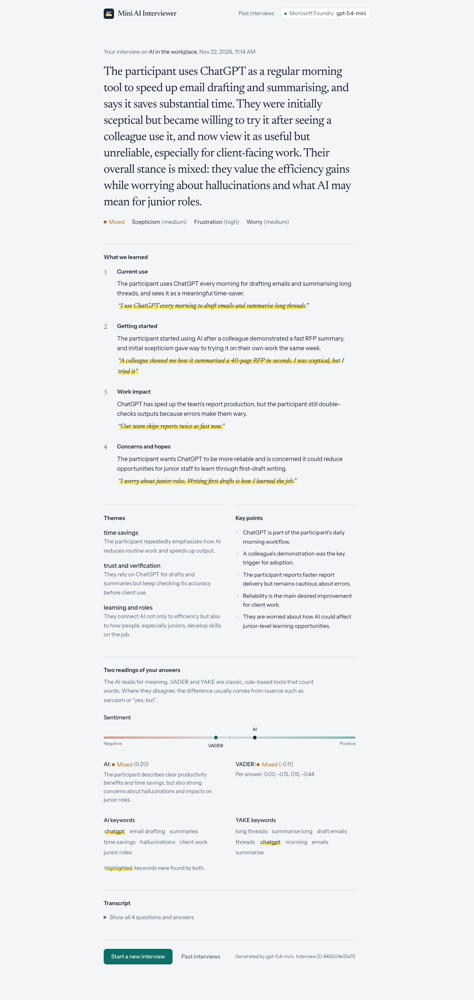
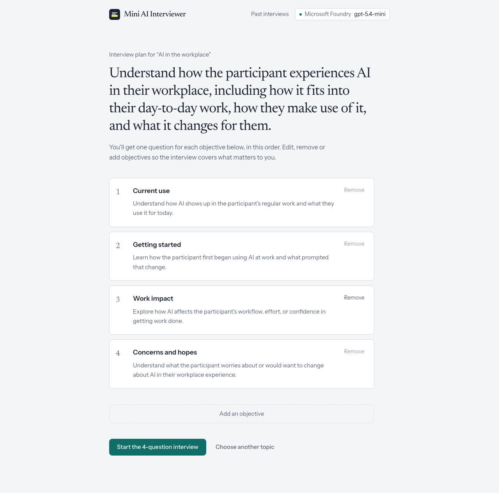
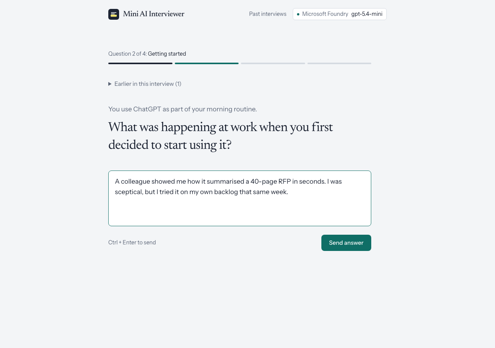
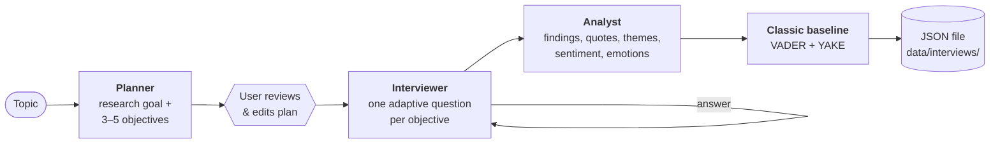

<div align="center">

# Mini AI Interviewer

**Short, adaptive AI-led interviews on any topic, with a summary grounded in the participant's own words.**

A simplified take on [Anthropic Interviewer](https://www.anthropic.com/news/anthropic-interviewer): plan → interview → analysis.

[](https://github.com/ssztnt/mini-ai-interview/actions/workflows/ci.yml)




</div>

---

## What it does

| | Assignment requirement | How it's handled |
|---|---|---|
| 1 | Start an interview on a chosen topic | Free-text topic or a suggested one, with 3–5 questions |
| 2 | Generate 3–5 sequential AI questions | The AI drafts an **editable plan**, then writes each question **live**, adapting to earlier answers |
| 3 | Collect answers interactively | One question at a time, with progress and the earlier conversation available |
| 4 | AI summary (themes, sentiment, key points) | Overview, **per-objective findings with verbatim quotes**, themes, key points, sentiment, emotions |
| 5 | Store transcript + summary | One readable JSON file per interview, plus a *Past interviews* view |
| ★ | Bonus: basic analysis | **VADER** sentiment and **YAKE** keywords, shown next to the AI's reading for comparison |

<table>
  <tr>
    <td></td>
    <td></td>
  </tr>
  <tr>
    <td align="center"><sub>Review and edit the AI's plan</sub></td>
    <td align="center"><sub>Questions adapt to what you said</sub></td>
  </tr>
</table>

## Quick start

**Prerequisites:** [uv](https://docs.astral.sh/uv/getting-started/installation/) (installs Python 3.12 for you) and Node.js 20.19+ (or 22+).

```bash
git clone https://github.com/ssztnt/mini-ai-interview.git
cd mini-ai-interview
cp .env.example .env          # optional: add an API key (see below)
```

```bash
# Terminal 1: API on http://localhost:8000
cd backend && uv run uvicorn app.main:app --reload
```

```bash
# Terminal 2: web app on http://localhost:5173
cd frontend && npm install && npm run dev
```

Open **http://localhost:5173**.

> [!TIP]
> **No API key? It still runs.** Without a key the backend starts in **demo mode** with canned questions and summaries, so you can click through the whole experience. The header shows which mode is active.

### Connect a model

Pick **one** option in `.env`, then restart the backend.

<details open>
<summary><b>Option A: OpenAI</b> (simplest)</summary>

```env
LLM_PROVIDER=openai
OPENAI_API_KEY=sk-...
OPENAI_MODEL=gpt-5.4-mini        # any chat model with structured-output support
```

Any **OpenAI-compatible** provider also works through `OPENAI_BASE_URL`, for example a local Ollama at `http://localhost:11434/v1`.

</details>

<details>
<summary><b>Option B: Microsoft Foundry</b></summary>

From the Foundry portal: **Build → Models → *your deployment* → Details**.

```env
LLM_PROVIDER=foundry
FOUNDRY_ENDPOINT=https://<your-resource>.openai.azure.com
FOUNDRY_API_KEY=...
FOUNDRY_DEPLOYMENT=gpt-5.4-mini  # your deployment name
```

The app calls Foundry's OpenAI-compatible `/openai/v1/` endpoint, so both providers share one client.

</details>

## How it works

The pipeline mirrors Anthropic Interviewer's three stages. Each stage has its own prompt with a single job.



### Prompt design

The prompts live as Markdown in [`backend/app/prompts/`](backend/app/prompts/), so they can be read without digging through code.

| Prompt | Job | Key techniques |
|---|---|---|
| [`planner.md`](backend/app/prompts/planner.md) | Topic → plan | Goals rather than questions; a natural arc (context → depth → reflection); neutral, experience-focused |
| [`interviewer.md`](backend/app/prompts/interviewer.md) | Plan + transcript → next question | Builds on something specific from the last answer; open-ended, non-leading, never double-barrelled; reflective (not evaluative) lead-ins |
| [`analyst.md`](backend/app/prompts/analyst.md) | Transcript → summary | One finding per objective, **backed by a verbatim quote**; proportionate to thin answers; reads for sarcasm and "yes, but" |

Across all three:

- **Context as "memory".** The model is stateless, so every interviewer call receives the topic, full plan, **full transcript so far**, current objective, and progress (`Question 2 of 4`).
- **Structured outputs.** Every response is parsed into a Pydantic schema (strict JSON schema), so the backend never parses free text.
- **Data vs instructions.** User input is wrapped in XML-style tags and the prompts say to treat it as data, which is a basic guard against prompt injection.
- **Trust, but verify.** Quotes the analyst attributes to the participant are checked against the real answers, and any that don't match are dropped.

## Project structure

```
mini-ai-interview/
├── backend/                  FastAPI · Python 3.12 · uv
│   ├── app/
│   │   ├── main.py           app factory, error mapping
│   │   ├── api.py            HTTP routes (thin)
│   │   ├── config.py         .env → provider / demo mode
│   │   ├── models.py         Pydantic domain + API models
│   │   ├── prompts/          planner.md · interviewer.md · analyst.md + message builders
│   │   ├── llm/              OpenAI/Foundry client · offline demo client
│   │   ├── services/         interview lifecycle · VADER/YAKE analysis
│   │   └── storage/          in-memory (live) · JSON files (completed)
│   ├── data/interviews/      saved interviews (sample included)
│   └── tests/                pytest, runs fully offline
├── frontend/                 React 19 · TypeScript · Vite · Tailwind
│   └── src/
│       ├── api/              typed client mirroring backend models
│       ├── screens/          Start · Plan · Interview · Analyzing · Summary · History
│       └── useInterview.ts   session state + refresh-safe resume
└── docs/                     architecture notes, screenshots
```

## API

Interactive docs at **http://localhost:8000/docs** once the backend is running.

| Method | Endpoint | Purpose |
|---|---|---|
| `GET` | `/api/config` | Active provider, model, and demo flag (never secrets) |
| `POST` | `/api/interviews` | Create an interview and generate its plan |
| `PUT` | `/api/interviews/{id}/plan` | Save the user's edited plan |
| `POST` | `/api/interviews/{id}/start` | Lock the plan and ask the first question |
| `POST` | `/api/interviews/{id}/answers` | Answer, then get the next adaptive question |
| `POST` | `/api/interviews/{id}/complete` | Summarise, analyse, and save to disk |
| `GET` | `/api/interviews` | Past interviews, newest first |
| `GET` | `/api/interviews/{id}` | One interview (live or saved) |

Each interview moves through `planning → in_progress → completed`, and out-of-order calls return `409`.

## Stored data

Each completed interview is written to `backend/data/interviews/<date>_<id>.json` and holds the topic, model, plan, full transcript with timestamps, the AI summary, and the classic analysis. See [`sample-ai-in-the-workplace.json`](backend/data/interviews/sample-ai-in-the-workplace.json): a real run on gpt-5.4-mini (Microsoft Foundry) with example answers. The screenshots above come from the same run.

## Development

```bash
cd backend  && uv run pytest && uv run ruff check .        # 37 offline tests
cd frontend && npm run lint && npm run build
```

CI runs both on every pull request.

## Design decisions & limitations

Short version below; the reasoning is in [`docs/architecture.md`](docs/architecture.md).

- **Plan + adapt** rather than a fixed question list: the plan keeps the interview on track, and live questions make it feel like a conversation.
- **The backend owns interview state**, so the browser can't skip steps or rewrite the transcript.
- **Limitation:** in-progress interviews live in memory and are lost on a server restart. Completed ones are on disk.
- **Limitation:** JSON files suit a POC. Thousands of interviews or concurrent writers would call for SQLite.
- **Next steps:** streaming questions, multi-participant studies with cross-interview theme clustering, export to Markdown or PDF.
