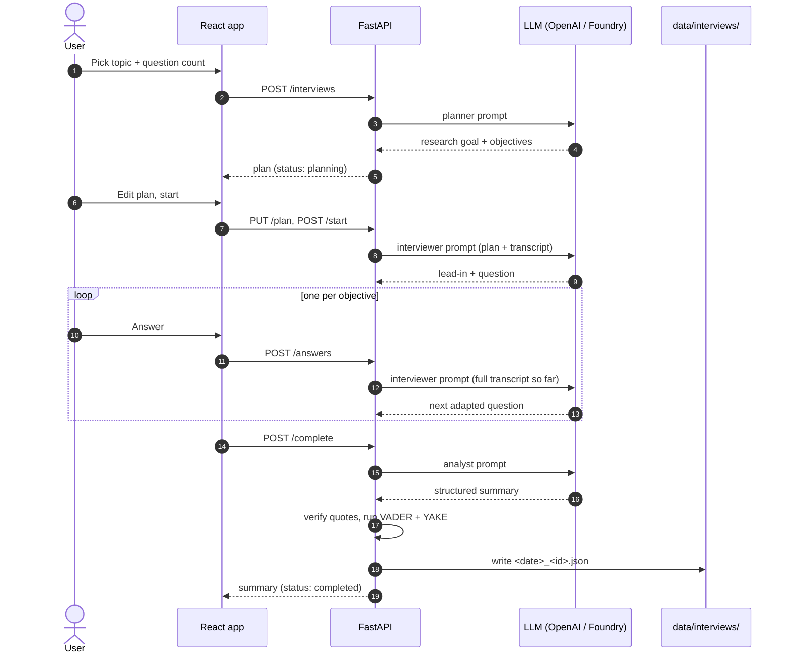

# Architecture & design decisions

This document explains **why** the app is built the way it is. For setup, see the [README](../README.md).

## Inspiration: Anthropic Interviewer

[Anthropic Interviewer](https://www.anthropic.com/news/anthropic-interviewer) runs research interviews in three stages:

1. **Planning.** From a research goal, it drafts an interview plan, and a human researcher reviews it.
2. **Interviewing.** It runs a real-time, adaptive conversation that follows the plan.
3. **Analysis.** It answers the research questions with supporting quotes, themes, and emotions.

This project keeps that structure at a smaller scale: one participant, 3–5 questions, and the participant acts as their own reviewer of the plan.

## Request flow

## Decisions

### Plan + adapt over a fixed question list

| Approach | Trade-off |
|---|---|
| Generate all questions up front | Simple, but can't react to answers. It feels like a survey. |
| Fully adaptive (no plan) | Conversational, but drifts off-topic. |
| **Plan, then adapt each question** ✅ | Stays on track *and* responds to the participant. Costs one extra LLM call. |

There is one question per objective, which keeps the count exactly within the required 3–5.

### Objectives are goals, not questions

Each plan item is a *theme* plus *what we want to learn*. The interviewer knows **why** it is asking, so it can rephrase freely around the participant's last answer and still hit the goal. Showing goals rather than ready-made questions also doesn't spoil the interview when the user reviews the plan.

### The backend owns interview state

The frontend only sends "here is my answer for interview `X`". The backend holds the plan and transcript, enforces the status flow (`planning → in_progress → completed`), and rejects out-of-order calls with `409`. Requests stay small, and the client can't skip steps or edit history.

**Retry-safe turns:** `answer()` works on a copy and only saves once the next question has been generated. If the LLM call fails, nothing is half-written, and resubmitting the same answer just works.

### Structured outputs everywhere

Every LLM call returns a Pydantic model, enforced as a strict JSON schema through the OpenAI SDK's `parse()`. The LLM schemas are deliberately free of constraints (strict mode supports only part of JSON Schema), and business rules such as plan size are enforced in Python afterwards. One extra attempt is made if the output is malformed.

### Verifying quotes

LLMs sometimes "tidy up" quotes. A quote attributed to the participant must be their actual words, so each one is matched against the transcript (ignoring whitespace, case, and surrounding quote marks), and any that don't match are dropped.

### Two readings of sentiment

The bonus analysis runs **VADER** (lexicon-based sentiment) and **YAKE** (statistical keyword extraction) alongside the LLM. They are deterministic, free, and offline. The UI plots both sentiment scores on one scale, because their *disagreements* are informative: VADER scores "I love it, but the setup was painful" as negative, whereas an LLM typically reads it as mixed.

### One client, two providers

Microsoft Foundry exposes an OpenAI-compatible `/openai/v1/` endpoint, so a single `OpenAIClient` covers OpenAI, Foundry, and any OpenAI-compatible server. `LLM_PROVIDER` only changes the base URL, key, and model name. With no key, a `DemoClient` implementing the same interface stands in, which is also what the test suite uses.

### Content filter: two layers

Swearing and harmful content are different problems, so two layers handle them:

| Layer | Catches | How |
|---|---|---|
| App word list ([`moderation.py`](../backend/app/services/moderation.py)) | Profanity, in Ofcom's three tiers: mild, moderate, strong | Whole-word regex, run before any LLM call; the level is set by `CONTENT_FILTER` |
| Provider (Azure AI Content Safety on Foundry) | Hate, sexual, violence, self-harm, scored safe / low / medium / high | Built in; blocks medium and above by default. Its `content_filter` error is mapped to the same response |

Both layers return `422` with `code: "inappropriate_language"`. The UI clears the rejected field, which it does by re-mounting the form with a new React `key`. The check runs in the service rather than the browser, so it can't be bypassed, and rejected text is never sent to the model or saved.

The default is the strictest level (`mild`, which blocks "hell") because an interview is a professional setting. The trade-off is that a participant can't quote a strong reaction word for word ("it was hell"). Teams that prefer that can relax it in `.env`.

### Storage

| Data | Where | Why |
|---|---|---|
| In-progress interviews | In-memory repository | Fast and simple; behind a small interface so it can be swapped later |
| Completed interviews | One JSON file each | Human-readable, so reviewers can open them directly; written atomically (temp file + rename) |

## Prompt iteration from real runs

Testing full interviews against gpt-5.4-mini on Microsoft Foundry surfaced issues that unit tests with the demo client can't catch:

| Observed | Change |
|---|---|
| Follow-ups joined two asks: "What first prompted you to try it, **and** what made it worth trying?" | The interviewer asks about exactly one thing (with a bad/good example), and planner goals became single-focus |
| A sentiment rationale contained a Hindi word mid-sentence | Analyst and interviewer are pinned to the participant's language |
| Finding labels copied the whole "theme: goal" line | Labels are now set from the plan in code |

The pattern: **state rules in the prompt, enforce what matters in code.** Quotes, labels, and plan size are verified after parsing instead of trusted.

## Limitations

- In-progress interviews are lost if the server restarts.
- JSON-file listing scans the folder, which is fine for hundreds of interviews but not millions.
- No authentication: this is a local, single-user proof of concept.
- The word list is English-only and can be beaten by spacing letters out ("f u c k"). A hosted moderation API would be the next step.
- Text only. As Anthropic notes for their own tool, tone of voice and hesitation are lost.

## Next steps

- Persist live interviews in SQLite and move history there too.
- Stream questions token by token for a snappier feel.
- Multi-participant studies: shared plans, plus clustering themes across interviews (as Anthropic does with Clio).
- Export a summary as Markdown or PDF.
